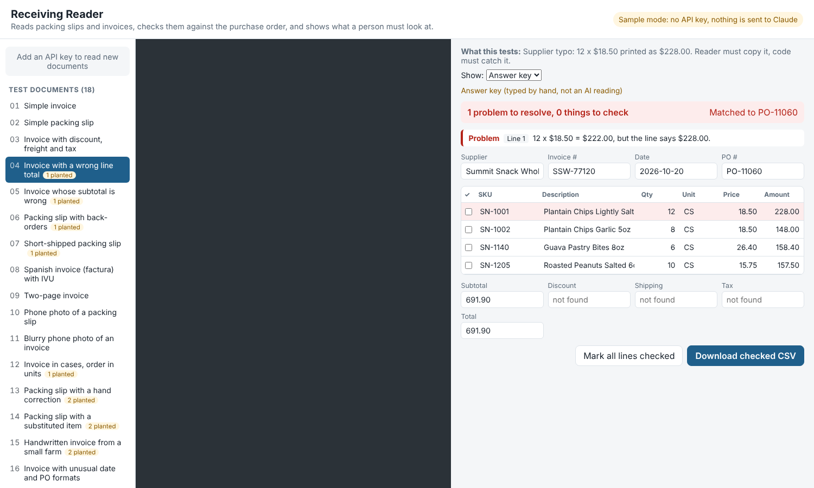

# Receiving Reader

Reads supplier **packing slips and invoices** (PDFs or phone photos) with the Claude API, checks them against the **purchase order**, and shows a person exactly which lines need a second look before the delivery is accepted. It comes with **18 made-up test documents and an accuracy test** that scores every field.



## Why I built it

I've worked as a stock manager for years, and receiving is where small paperwork mistakes turn into inventory problems: a short shipment nobody noticed, a supplier's math error on an invoice, a substituted item, a case counted as one unit. This project is the tool I wanted at the receiving dock.

The AI only does the part that needs eyes: **reading the paper**. Everything that decides whether the delivery is right is plain, tested code, and a person makes the final call.

## How it works

```
 PDF or photo ──► Claude API ──► JSON in a fixed shape ──► plain-code checks ──► review screen ──► CSV
                 (structured       (validated with Zod)      math + purchase       person fixes,
                  outputs)                                   order comparison      checks, exports
```

1. **Read.** The back end sends the document to Claude with instructions (`server/prompt.ts`) and a required output shape (`src/shared/schema.ts`). The API forces the answer into that shape, and the code checks it again with Zod before trusting it. The model is told to copy what is printed, never fix numbers, and use `null` instead of guessing.
2. **Check.** `src/shared/checks.ts` runs ordinary TypeScript checks:
   - **Math:** quantity x price = line amount, lines add up to the subtotal, subtotal + tax + freight − discount = total.
   - **Purchase order:** short or over shipments, back-orders, items not on the PO (substitutions), ordered items that never arrived, billed price different from the PO price, and cases vs. eaches (3 CS of 12 = 36 EA) when the pack size is printed.
   - **Reading quality:** missing quantities or item numbers, duplicate lines, lines the model marked as low confidence.
3. **Review.** The screen shows the original document next to what was read. Problem lines are red, lines to double-check are amber, and every field can be corrected. The checks re-run on each edit.
4. **Export.** The checked result downloads as a CSV for Excel or Google Sheets.

The API key stays on the small back end (`server/`) and never reaches the browser.

## Accuracy

`npm run eval` runs the 18 test documents through the reader and compares every field with a hand-made answer key: header fields, every line item field, and whether the checks caught the problems planted in each document. It writes a report to `eval/reports/` listing accuracy by field and every wrong value.

| Model | Field accuracy | Planted problems caught | Cost for 18 documents |
|---|---|---|---|
| _not run yet_ | | | |

_This table gets filled in from a real run. No numbers here are estimates._

## Run it

You need [Node.js 22 or newer](https://nodejs.org/).

```bash
npm install
npm run dev          # opens the app at http://localhost:5173
```

Without an API key the app runs in **sample mode**: you can browse the 18 test documents, see the checks working on their answer keys, edit fields and export CSV. Nothing is sent anywhere.

To read new documents, copy `.env.example` to `.env` and add your Anthropic API key. Then:

```bash
npm run eval:dry                  # what a full accuracy run would cost (free)
npm run eval                      # run it (asks before spending)
npm run eval -- --only 01,13      # just some documents
npm run eval -- --replay          # re-score a saved run for free
npm run eval -- --model claude-sonnet-5-5   # compare another model
```

Other commands: `npm test` (unit tests, no API calls), `npm run check` (types + tests), `npm run samples` (rebuild the test documents; needs Playwright's Chromium).

## Cost controls

- The default model is **Claude Haiku 5.5**, the cheapest current Claude model. A full 18-document run is estimated at about **$0.03**. Sonnet 5.5 is about $0.58 and Opus 5.5 about $1.17 (estimates run high on purpose).
- Every paid run shows its estimate first and asks for "yes". `--max-usd` caps a run (default $1).
- The project keeps a local spend log and refuses paid calls once it reaches `SPEND_LIMIT_USD` (default $2).
- Also set a monthly spend limit in the Claude Console. That is the limit that protects the card.

## Test documents

All 18 are **fictional**: every company, address, item number and price is made up, and each document says so in small print. They are generated from `samples/data.ts`, which also produces the answer key and purchase order for each one, so the answer key always matches the paper. A unit test checks that a perfect reading of each document raises exactly the planned problems.

| # | Document | Type | What it tests | Planted problems |
|---|---|---|---|---|
| 01 | Simple invoice | PDF | A clean, typed invoice that matches its PO. The easy baseline. | - |
| 02 | Simple packing slip | PDF | Packing slip with no prices. Ordered and shipped columns agree. | - |
| 03 | Invoice with discount, freight and tax | PDF | Totals block with four parts. Reader must put each amount in the right field. | - |
| 04 | Invoice with a wrong line total | PDF | Supplier typo: 12 x $18.50 printed as $228.00. Reader must copy it, code must catch it. | `line_math` |
| 05 | Invoice whose subtotal is wrong | PDF | Lines are right but the subtotal is $10 too high. Code must catch it. | `subtotal_mismatch` |
| 06 | Packing slip with back-orders | PDF | Ordered / shipped / back-ordered columns. Reader must take shipped, not ordered. | `backordered` |
| 07 | Short-shipped packing slip | PDF | Supplier sent 18 of the 24 ordered with no back-order note. Must be flagged against the PO. | `qty_short` |
| 08 | Spanish invoice (factura) with IVU | PDF | Spanish labels, day/month date, cases with 'caja de 12', and IVU tax. | - |
| 09 | Two-page invoice | PDF | 28 lines that run onto a second page. Reader must not drop or repeat lines. | - |
| 10 | Phone photo of a packing slip | Photo | Same kind of slip as a crooked phone photo on a desk. | - |
| 11 | Blurry phone photo of an invoice | Photo | Lower-quality photo, more tilt and blur. Tests how reading holds up on bad input. | - |
| 12 | Invoice in cases, order in units | PDF | Billed in cases (12/CS), ordered in eaches: 3 CS = 36 EA. One line in boxes with no pack size must be counted by hand. | `unit_mismatch` |
| 13 | Packing slip with a hand correction | Photo | The 10 printed on one line is crossed out and 8 written by hand. Reader must use 8 and mark it low confidence. | `qty_short`, `low_confidence` |
| 14 | Packing slip with a substituted item | PDF | Supplier sent a different item number in place of one that was ordered. | `not_on_po`, `missing_from_shipment` |
| 15 | Handwritten invoice from a small farm | Photo | Handwritten, Spanish, no item numbers and no PO number, like many small local suppliers. | `missing_sku`, `po_missing` |
| 16 | Invoice with unusual date and PO formats | PDF | Date printed as 07-OCT-26 and PO as 'PO# 4500-0193' while the store's system stores 45000193. | - |
| 17 | Invoice with the same item twice | PDF | One item billed on two lines (two lots). Together they are more than was ordered. | `duplicate_sku`, `qty_over` |
| 18 | Photo of a Spanish invoice billed above the PO price | Photo | Phone photo, Spanish. Coffee billed at $62.40 a case when the PO says $58.80. | `price_mismatch` |

## Project layout

```
server/          back end: Claude call (extract.ts), prompt, cost estimate, spend limit, HTTP routes
src/shared/      code used by both sides: schema, checks, scoring, CSV export
src/web/         the review screen (React + TypeScript)
samples/         test documents, answer keys, purchase orders, and the generator
eval/            the accuracy test; results/ and reports/ are written by runs
tests/           unit tests (Vitest), no API calls
```

## Limits

- One document per request, up to 10 MB. Very long invoices may need to be split.
- Purchase orders are JSON files standing in for a real purchasing system.
- The test set is 18 documents I generated. Real supplier paperwork is messier, so a real deployment would need its own test set from real (permitted) documents.
- It reads and checks; it does not update any inventory system.

## How I built it

Built with Claude Code. I described the receiving process and the problems I see at work; Claude Code wrote the code, the sample documents and the tests. _[Mel: say here, truthfully, what you reviewed, ran and changed yourself.]_
